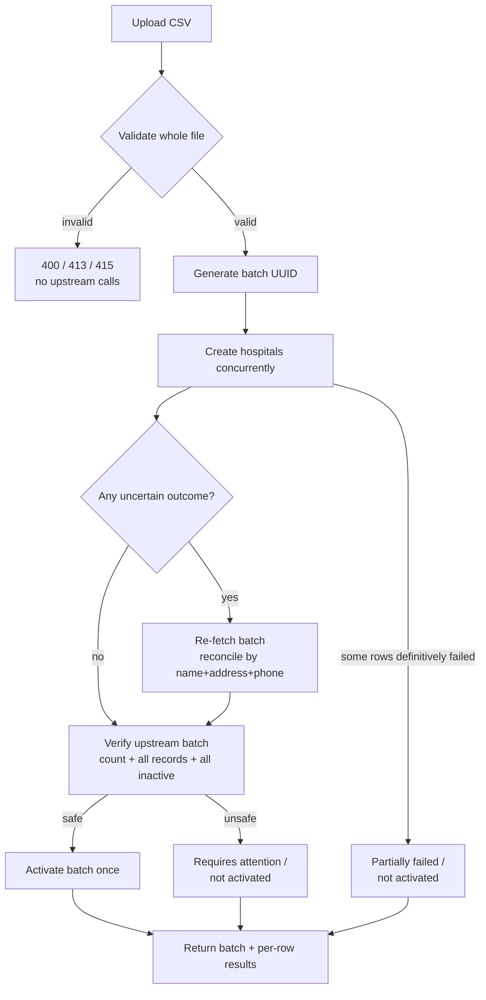
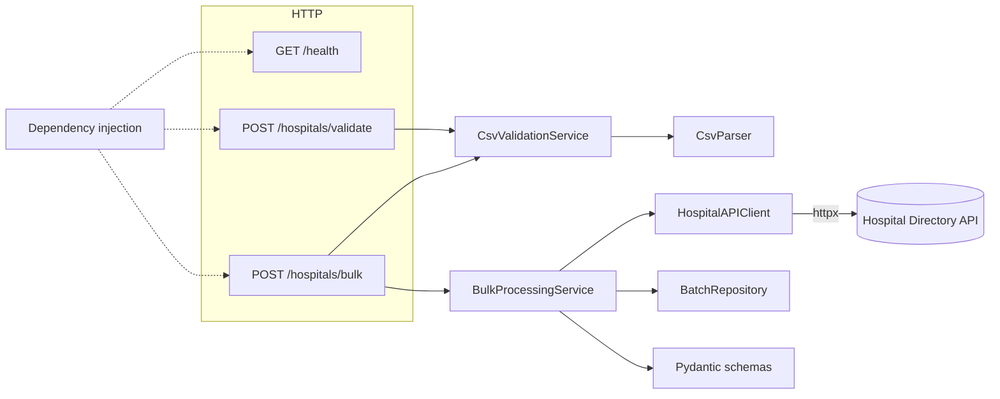

# Hospital Bulk Processing

A Python/FastAPI service that turns a hospital **CSV upload** into a batch of
**real hospital records** in an external Hospital Directory API — with
validation up front, safe concurrent creation, reconciliation of uncertain
results, and activation that only happens when it is provably safe.

This is a production service layered on top of the
[Hospital Directory API](https://hospital-directory.onrender.com/docs): the
upstream system manages individual hospitals and batch activation, and this
project adds bulk CSV ingestion and a resilient processing engine on top of it.

[](https://www.python.org/)
[](https://fastapi.tiangolo.com/)
[](https://docs.pydantic.dev/)
[](https://www.python-httpx.org/)
[](https://docs.pytest.org/)
[](https://www.docker.com/)

---

## Contents

- [Live application](#live-application)
- [What this project does](#what-this-project-does)
- [How the processing workflow works](#how-the-processing-workflow-works)
- [Architecture overview](#architecture-overview)
- [API reference](#api-reference)
- [Test it in a few minutes](#test-it-in-a-few-minutes)
- [Run it locally](#run-it-locally)
- [Docker](#docker)
- [Deploy to Render](#deploy-to-render)
- [Configuration](#configuration)
- [Testing & quality](#testing--quality)
- [Important limitations](#important-limitations)

---

## Live application

| Resource | URL |
|---|---|
| **Live API** | https://hospital-bulk-processing-e0o5.onrender.com |
| **Health check** | https://hospital-bulk-processing-e0o5.onrender.com/health |
| **Swagger UI** | https://hospital-bulk-processing-e0o5.onrender.com/docs |
| **OpenAPI JSON** | https://hospital-bulk-processing-e0o5.onrender.com/openapi.json |
| **GitHub** | https://github.com/Viratsoam/hospital-bulk-processing |
| **Upstream Hospital Directory API** | https://hospital-directory.onrender.com/docs |

> The live service runs on Render's free tier, so it may sleep after idle
> periods. The first request after a sleep can take up to a minute to respond
> while it wakes up. This is expected, not an error.

---

## What this project does

**The problem.** Hospitals need to be registered in an external Directory API.
A team often has a spreadsheet of hospitals and wants to push them all at once,
but they also want a strong guarantee about what happens: no silent partial
writes, no duplicate records, and no batch activation until everything is
confirmed in the right state.

**What this service provides.** A single endpoint that:

1. Accepts a CSV file of hospitals.
2. Validates the *whole* file before creating anything.
3. Creates each hospital concurrently in the upstream API under one shared
   batch ID.
4. Reconciles any creation whose outcome was uncertain.
5. Verifies the upstream batch is exactly right.
6. Activates the batch **once**, and only when every safety check passes.

The result is a clear, per-row report of what happened — including the rows
that failed — so operators always know the exact outcome.

---

## How the processing workflow works

Given a CSV with valid rows, here is what happens on `POST /hospitals/bulk`:

1. **Upload.** The client sends a multipart CSV.
2. **Parse & validate.** The full file is parsed and validated. If *anything*
   is wrong (bad header, a missing value, more than 20 records, bad
   encoding), the request is rejected **before** a single upstream call is
   made.
3. **Batch ID.** A unique UUID is generated and shared by every record in
   this run. This is how the upstream API groups the hospitals into one batch.
4. **Concurrent creation.** Each hospital is sent to the upstream API
   **in parallel**, bounded by a configurable limit, so a 20-row file does not
   take 20× as long.
5. **Reconciliation.** If a creation times out or returns an ambiguous result
   (the request may or may not have landed upstream), the service does *not*
   blindly re-send it. Instead it re-fetches the batch and matches records by
   `(name, address, phone)` — using occurrence counts, not set membership, so
   duplicate rows are handled correctly.
6. **Verification.** Before activation the upstream batch is checked: the
   record count matches the input, every expected record is present, and every
   hospital is explicitly *inactive*.
7. **Safe activation.** The batch is activated **exactly once**, and only if
   all checks passed. An ambiguous activation result is never retried
   automatically.
8. **Report.** The API returns a structured result with a batch status,
   counts, and one outcome per input row.

### Why each piece matters

- **Concurrency** keeps large batches fast without hammering the upstream API.
- **The shared batch UUID** is the only idempotency key the upstream API
  provides, so it is what ties every record to a single activatable batch.
- **Reconciliation** protects against the classic bug where a request times
  out, the server *did* create the record, and a naive retry creates a
  duplicate.
- **Safe activation** means you never activate a batch that is incomplete or
  already partially active — that state is hard to undo.



---

## Architecture overview

The code is split into small, single-responsibility pieces. A request flows
from thin HTTP routes down through clearly separated layers.



| Layer | Responsibility |
|---|---|
| **FastAPI routes** (`app/api/routes/`) | Translate HTTP: read the upload, pick the right status code, return the response model. They do *no* business logic. |
| **CSV parser** (`app/services/csv_parser.py`) | Pure CSV mechanics: decode bytes, parse rows, normalize whitespace. No business rules. |
| **Validation service** (`app/services/validation_service.py`) | Business rules: required headers, per-row values, max record count, file size. Returns *every* problem, not just the first. |
| **Hospital API client** (`app/clients/hospital_api_client.py`) | The only place that talks to the upstream service. Handles timeouts, retries, and turns all failures into normalized, typed errors. |
| **Bulk processing service** (`app/services/bulk_processing_service.py`) | The engine: concurrency, reconciliation, verification, and single activation. |
| **Batch repository** (`app/repositories/batch_repository.py`) | Where batch records are stored (in-memory for now). The interface is clean so a durable backend can drop in later. |
| **Pydantic schemas** (`app/schemas/`) | The contracts: request/response shapes and the explicit batch/row status enums. |
| **Dependency injection** (`app/api/dependencies.py`) | Wires the shared client, repository, and service into routes — and is the seam tests use to inject mocks. |
| **Application lifespan** (`app/main.py`) | Creates the shared `httpx` client and repository on startup and closes the client on shutdown, so the process owns one connection pool for its whole lifetime. |

**Key engineering ideas, in plain terms:** the layers never do each other's
jobs, so each can be tested on its own. The service holds one shared HTTP
client for the lifetime of the process (created in the FastAPI lifespan,
closed on shutdown) rather than opening a connection pool per request. And
every failure from the upstream API is converted into a typed, structured
error so the rest of the app can reason about outcomes instead of catching
raw HTTP.

---

## API reference

All endpoints are `multipart/form-data` for the two CSV endpoints, with a
single file field named **`file`**.

### `GET /health`

Reports that the service process is up. It makes **no** downstream calls — it
answers "is this process alive?", not "can I reach the upstream API?".

Example response:

```json
{
  "status": "ok",
  "service": "Hospital Bulk Processing",
  "version": "0.1.0",
  "environment": "production"
}
```

---

### `POST /hospitals/validate`

Validate a CSV **without creating anything**. This is the dry-run endpoint.

- **Request:** multipart form, field `file` = a `.csv` upload.
- **CSV columns:** `name` and `address` required; `phone` optional.
- **Maximum:** 20 records.

**Valid response** (`200`, `valid: true`) — no hospitals were created:

```json
{
  "valid": true,
  "total_records": 2,
  "hospitals": [
    { "row": 2, "name": "Demo North Hospital", "address": "101 Sample Road", "phone": "555-0101" },
    { "row": 3, "name": "Demo South Hospital", "address": "202 Example Avenue", "phone": null }
  ],
  "errors": []
}
```

**Invalid response** (`200`, `valid: false`) — a problem list, one entry per
issue, each with a stable machine-readable `code`:

```json
{
  "valid": false,
  "total_records": 0,
  "hospitals": [],
  "errors": [
    {
      "row": null,
      "field": "name",
      "code": "missing_headers",
      "message": "Required column 'name' is missing from the header. Expected columns: name, address, phone."
    }
  ]
}
```

An invalid file is a *business* outcome, so the endpoint returns `200` with
`valid: false` — not a 4xx — which lets a caller fix the whole file in one
pass.

---

### `POST /hospitals/bulk`

Validate, create, reconcile, and activate a batch.

- **Request:** multipart form, field `file` = a `.csv` upload.
- **CSV columns:** `name`, `address` (required), `phone` (optional).
- **Maximum:** 20 records.

**Success** (`200`, batch activated):

```json
{
  "batch_id": "b4e9f7a3-7b3b-4f1f-9a3a-5f5b8a9c3f2a",
  "status": "completed",
  "total_records": 2,
  "processed_records": 2,
  "successful_records": 2,
  "failed_records": 0,
  "unknown_records": 0,
  "processing_time": 5.6,
  "batch_activated": true,
  "activated_count": 2,
  "error_summary": null,
  "results": [
    { "row_number": 2, "name": "Demo North Hospital", "address": "101 Sample Road", "phone": "555-0101", "status": "created", "upstream_hospital_id": 2589, "error_message": null },
    { "row_number": 3, "name": "Demo South Hospital", "address": "202 Example Avenue", "phone": null, "status": "created", "upstream_hospital_id": 2590, "error_message": null }
  ]
}
```

**Partial failure** (`200` — a business outcome, not a server error; the batch
is **not** activated, but rows that did succeed are preserved):

```json
{
  "batch_id": "b4e9f7a3-7b3b-4f1f-9a3a-5f5b8a9c3f2a",
  "status": "partially_failed",
  "total_records": 2,
  "processed_records": 2,
  "successful_records": 1,
  "failed_records": 1,
  "unknown_records": 0,
  "processing_time": 6.9,
  "batch_activated": false,
  "activated_count": null,
  "error_summary": "1 record(s) failed to create of 2",
  "results": [
    { "row_number": 2, "name": "Demo North Hospital", "address": "101 Sample Road", "phone": "555-0101", "status": "created", "upstream_hospital_id": 2589, "error_message": null },
    { "row_number": 3, "name": "Demo South Hospital", "address": "202 Example Avenue", "phone": null, "status": "failed", "upstream_hospital_id": null, "error_message": "[validation_error] Upstream create hospital returned HTTP 422" }
  ]
}
```

**Batch `status` values:** `processing`, `completed`, `partially_failed`,
`created_not_activated`, `requires_attention`.

**Row `status` values:** `pending`, `processing`, `created`, `failed`,
`unknown`.

**HTTP status codes**

| Code | Meaning |
|------|---------|
| `200` | Processing completed — including partial failures and activation problems. |
| `400` | Invalid CSV (bad headers, missing values, too many records, …); nothing was created. |
| `413` | Upload exceeds the configured byte limit. |
| `415` | Upload is not a CSV file. |
| `422` | Missing `file` part, or a malformed multipart body. |
| `500` | Unexpected internal error. |

Every `200` response returns the full per-row `results` array, so a caller can
always see exactly which rows succeeded.

---

## Test it in a few minutes

You can exercise the real behavior in a couple of minutes using the sample
CSV below.

**Step 1 — create a sample file** (copy-paste):

```bash
cat > sample-hospitals.csv <<'EOF'
name,address,phone
Demo North Hospital,101 Sample Road,555-0101
Demo South Hospital,202 Example Avenue,
EOF
```

- `name` and `address` are **required**; `phone` is **optional** (the second
  row intentionally leaves it empty to show that).
- **Maximum 20 records** per file.

**Step 2 — run a command.**

### A. Validate locally (no records created)

```bash
curl -F "file=@sample-hospitals.csv" http://127.0.0.1:8000/hospitals/validate
```

Validates the file and returns `valid` plus the parsed rows. **Nothing is
created anywhere.** Safe to run as often as you like.

### B. Validate using the live production API

```bash
curl -F "file=@sample-hospitals.csv" https://hospital-bulk-processing-e0o5.onrender.com/hospitals/validate
```

Same as above, but against the deployed service. Still **no records are
created.**

### C. Execute bulk processing locally

```bash
curl -F "file=@sample-hospitals.csv" http://127.0.0.1:8000/hospitals/bulk
```

> ⚠️ This creates **real** hospital records in the upstream Hospital Directory
> API under a new batch, then activates the batch. If your local environment
> points at the real upstream URL, this is a write operation.

### D. Execute bulk processing using the live production API

```bash
curl -F "file=@sample-hospitals.csv" https://hospital-bulk-processing-e0o5.onrender.com/hospitals/bulk
```

> **⚠️ IMPORTANT:** The live bulk endpoint creates **real hospital records**
> in the upstream Hospital Directory API. These records **persist**. Repeated
> requests may create **duplicates**. Validate the CSV first (command B) and
> only submit test data when you *intentionally* want to create records.

**What each command does:**

- **A / B (validate):** parse + validate only. Read-only. Use this first to
  check your file.
- **C / D (bulk):** validate, then create + reconcile + activate. This is the
  write path — C/D touch the real upstream API.

### Testing with Swagger

1. Open [Swagger UI](https://hospital-bulk-processing-e0o5.onrender.com/docs) (live) or `http://127.0.0.1:8000/docs` (local).
2. Find the endpoint you want (`/hospitals/validate` or `/hospitals/bulk`).
3. Click **"Try it out"**, then the **"Execute"** button.
4. In the request form, upload your CSV into the `file` field.
5. Run the request and read the response shown right there.

> Tip: opening a `POST` URL directly in a browser does **not** execute the
> request — you must use "Try it out" in Swagger, `curl`, or a client that
> sends a proper multipart `POST`.

---

## Run it locally

Prerequisites: Python 3.8+ (the project is pinned to dependencies that
support 3.8+; the development virtual environment uses Python 3.12).

```bash
# 1. Clone
git clone https://github.com/Viratsoam/hospital-bulk-processing.git
cd hospital-bulk-processing

# 2. Create and activate a virtual environment
python3 -m venv .venv
source .venv/bin/activate        # on Windows: .venv\Scripts\activate

# 3. Install dependencies (runtime + test deps)
pip install -r requirements-dev.txt

# 4. Configure environment variables (optional — every value has a default)
cp .env.example .env            # then edit as needed; you can also skip this

# 5. Start the server
uvicorn app.main:app --reload

# 6. Open Swagger
open http://127.0.0.1:8000/docs   # or just visit it in a browser

# 7. Run the tests
pytest -v
```

- `requirements.txt` holds the runtime dependencies (FastAPI, Uvicorn,
  Pydantic, httpx, …).
- `requirements-dev.txt` adds the test tooling (pytest, pytest-asyncio,
  respx) and includes `requirements.txt`, so installing it once is enough.

---

## Docker

Build and run the production image locally. The image needs **no** `.env`
file — every setting has a default and is overridden through environment
variables.

```bash
# Build
docker build -t hospital-bulk-processing .

# Run on the default port 8000
docker run --rm -p 8000:8000 hospital-bulk-processing

# Run on a custom port (like the one Render assigns)
docker run --rm -p 10000:10000 -e PORT=10000 hospital-bulk-processing
```

The container listens on `0.0.0.0:$PORT` (default `8000`). Verify it:

```bash
curl http://127.0.0.1:10000/health        # {"status":"ok",...}
```

- Swagger: `http://127.0.0.1:10000/docs`
- OpenAPI: `http://127.0.0.1:10000/openapi.json`

The image runs as an unprivileged user and shuts down gracefully (closing the
shared HTTP client) when stopped.

---

## Deploy to Render

The repository includes a Render Blueprint (`render.yaml`) describing a
Docker-based web service with a `/health` readiness check.

**Using the Blueprint:**

1. Push the repository to GitHub.
2. In the Render dashboard, create a **Web Service** from the blueprint (or run
   `render up` from the repo root with the Render CLI).
3. Render builds the image from `Dockerfile`, starts the service, and probes
   `GET /health` for readiness. The `PORT` Render assigns is picked up
   automatically.

**Manual alternative:** create a *Web Service* → *Docker* runtime, point at
the `Dockerfile` in the repo root, set **Health Check Path = `/health`**, and
optionally add `HBP_ENVIRONMENT=production`.

Once deployed, access it with the same endpoints documented above:
`/health`, `/docs`, `/openapi.json`, `/hospitals/validate`, and
`/hospitals/bulk` — all on `https://<your-service>.onrender.com`.

---

## Configuration

All settings are read from environment variables using the `HBP_` prefix
(plus the container's `PORT`). Every variable has a working default, so the
service starts with **zero configuration**. `.env.example` lists all of them.

| Variable | Default | Meaning |
|---|---|---|
| `HBP_HOSPITAL_API_BASE_URL` | `https://hospital-directory.onrender.com` | Upstream Hospital Directory API host. |
| `HBP_HOSPITAL_API_TIMEOUT_SECONDS` | `75` | Read timeout. Generous by design to absorb Render cold starts. |
| `HBP_HOSPITAL_API_CONNECT_TIMEOUT_SECONDS` | `5` | Connect timeout. |
| `HBP_HOSPITAL_API_MAX_CONCURRENCY` | `20` | Max concurrent upstream create calls. |
| `HBP_HOSPITAL_API_MAX_RETRIES` | `1` | Retries after the initial attempt (total attempts = 1 + this). |
| `HBP_MAX_HOSPITALS_PER_BATCH` | `20` | Max CSV records accepted per batch. |
| `HBP_MAX_CSV_SIZE_BYTES` | `1000000` | Max upload size in bytes. |
| `HBP_ENVIRONMENT` | `local` | `production` when deployed to Render. |
| `HBP_LOG_LEVEL` | `INFO` | Log verbosity. |
| `PORT` | `8000` | Port the container binds to (set automatically by Render). |

Additional non-tunable app settings: `HBP_APP_NAME`, `HBP_APP_VERSION`, and
`HBP_CORS_ALLOW_ORIGINS` are also supported by the `Settings` model.

The production service does **not** rely on a local `.env` file — all values
come from the process environment.

---

## Testing & quality

Run the whole suite:

```bash
pytest -v
```

**127 tests pass** (verified against the current code base). They are spread
across five files:

| File | Focus |
|---|---|
| `tests/test_validation_service.py` | One test per CSV validation rule (headers, rows, limits, encoding, BOM, duplicates). |
| `tests/test_api.py` | HTTP-level behavior of the validate and health endpoints. |
| `tests/test_hospital_api_client.py` | The upstream client: retries, timeouts, error normalization, malformed responses. |
| `tests/test_bulk_processing_service.py` | The engine: reconciliation, activation gating, concurrency, duplicates. |
| `tests/test_bulk_api.py` | Full HTTP integration of `/hospitals/bulk` end to end. |

**How external calls are mocked.** No test makes a real network request. The
upstream API is stubbed two ways: the HTTP client tests use
[`respx`](https://github.com/lmenezes/respx) to mock `httpx` at the
transport level (plus injected mock transports for connection/timeout
failures), and the engine + integration tests use a small programmable fake
client injected through FastAPI's dependency-override seam. The concurrency
limit is verified by counting in-flight calls against the fake.

> Coverage percentage is not asserted here because it is not measured as part
> of the default suite; the claims above are about scenario breadth, not a
> numeric coverage figure.

---

## Important limitations

Being transparent about what this system does and does not do:

- **In-memory batch storage.** Batch records live in
  `InMemoryBatchRepository`, so the local audit trail of batch outcomes is
  **lost when the service restarts or is redeployed**. The repository is an
  interface, so a durable backend (e.g. a database) can replace it without
  touching the processing engine.
- **Created hospitals persist upstream.** Successfully created records stay
  in the Hospital Directory API even after this service restarts — the batch
  *audit* is lost, but the *records* are not.
- **Render free-tier sleep.** Idle services sleep and can take up to a minute
  to answer the first request after a sleep.
- **Upstream is an external dependency.** The Hospital Directory API is a
  separate service; its availability and latency affect this one. The client's
  generous read timeout and retry/ambiguous-outcome handling are built to
  tolerate that.

None of these block the stated functionality — they are documented so
operators know exactly what to expect.

---

*This project was built to pass a systems-engineering assignment: a layered,
test-driven, production-ready service that safely turns a CSV into activated
hospital batches. Try the live Swagger UI above, or clone the repo and run
the sample commands to see it end to end.*
